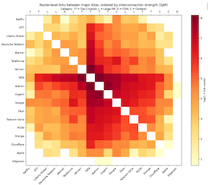

[README](README.md) | [Introduction](Introduction.md) | [Background](Background.md) | [Datasets](Datasets.md) | [SQL](SQL.md) | [Tasks](Task.md) | [Task 1](Task-1.md) | [Task 2](Task-2.md) | Task 3 ⮕ | [Notebook](nids-itdk.ipynb)

# Task 3: Multi-AS Interconnection Analysis — How-To Guide

## The 18 Autonomous Systems

| ASN   | Name             | Code | Category       |
| ----- | ---------------- | ---- | -------------- |
| 174   | Cogent           | I    | ISP            |
| 701   | Verizon          | I    | ISP            |
| 1299  | Arelion          | I    | ISP            |
| 3257  | GTT              | I    | ISP            |
| 3491  | PCCW             | I    | ISP            |
| 5511  | Orange           | I    | ISP            |
| 6453  | TATA             | I    | ISP            |
| 3320  | Deutsche Telekom | I    | ISP            |
| 6461  | Zayo             | I    | ISP            |
| 6762  | Telecom Italia   | I    | ISP            |
| 6830  | Liberty Global   | I    | ISP            |
| 12956 | Telefonica       | I    | ISP            |
| 15133 | Edgecast         | D    | CDN            |
| 20940 | Akamai           | D    | CDN            |
| 714   | Apple            | C    | Content        |
| 2906  | Netflix          | C    | Content        |
| 13335 | Cloudflare       | C    | Content        |
| 15169 | Google           | C    | Content        |

The static table above lists the 18 ASes grouped by category (transit backbone first, content last), then by ASN, with the single-letter `Code` used to annotate the heatmap. The heatmap itself does **not** follow this order — see the next section.

## Reordering the Heatmap with the Quadratic Assignment Problem (QAP)

If the heatmap axes stayed fixed in category/ASN order, clustering would only be visible if the real interconnection structure happened to line up with that category grouping. Instead, the notebook solves a **Quadratic Assignment Problem (QAP)** to find a placement of the 18 ASes along the axis that puts heavily-linked pairs next to each other, so dense clusters show up as visible blocks near the diagonal regardless of category.

Concretely, this is a linear-arrangement (seriation) problem: assign each AS a position `0..17` on the axis, minimizing

```
sum_ij  W[i,j] * |pos_i - pos_j|
```

where `W[i,j]` is the router-level link count between AS `i` and AS `j`. In words: pairs with more links should end up spatially closer together on both axes. `scipy.optimize.quadratic_assignment(W, D)` solves exactly this — it minimizes `trace(Wᵀ P D Pᵀ)` over permutation matrices `P`, with `D[p, q] = |p - q|` encoding "distance along the axis."

The default single solver run (barycenter start) can land in a mediocre local optimum, so the notebook restarts 30 times from randomized starting permutations and keeps the lowest-objective (best-clustering) result, using a fixed RNG seed for reproducibility. Print `best.fun` and the resulting AS order so you can see how the axis was reordered.

Because the QAP reordering breaks the category grouping (an ISP can end up next to a CDN if the two are heavily linked), the heatmap adds a one-letter `Code` strip (I/D/C, from the table above) along the top axis so each column's category is still identifiable after reordering.

## Counting Links Between Every AS Pair

The count of router-level links for each pair of the 18 ASes comes from one
query. The trap is fan-out: `itdk_link_endpoints` has many rows per link and
`itdk_node_as` many rows per node, so joining them directly explodes the row
count. Instead, first collapse to the grain you need — one `(link_id, asn)` per
endpoint — in a [CTE](SQL.md#34-staging-a-query-with-a-cte-with), then self-join
that small result. This is the complete query used in the notebook (it returns
`pair_df`):

```sql
WITH le_as AS (
    -- Collapse to one row per (link, AS): which of the 18 ASes touches each
    -- link. DISTINCT removes the duplicates created by multiple endpoints/ASNs.
    SELECT DISTINCT le.link_id, na.asn
    FROM caida_itdk.itdk_link_endpoints le
    JOIN caida_itdk.itdk_node_as na ON na.node_id = le.node_id
    WHERE na.asn IN (/* asn_list */)     -- the 18 ASNs, interpolated from Python
)
-- Self-join on link_id: a link joining AS `a` and AS `b` appears once in each.
-- `a.asn < b.asn` keeps only one direction, so each unordered pair is counted
-- once (not twice). COUNT(*) is already a distinct-link count thanks to the CTE.
SELECT a.asn AS asn1, b.asn AS asn2, COUNT(*) AS link_count
FROM le_as a
JOIN le_as b ON b.link_id = a.link_id AND a.asn < b.asn
GROUP BY a.asn, b.asn
ORDER BY link_count DESC;
```

The ASN list is interpolated from Python with an f-string — see
[SQL §3.6](SQL.md#36-interpolating-a-python-list-into-an-in-clause):

```python
asn_sql = ", ".join(str(a) for a in asn_list)   # "174, 701, 1299, ..."
pair_df = pd.read_sql(f"""... WHERE na.asn IN ({asn_sql}) ...""", engine)
pair_df["name1"] = pair_df["asn1"].map(ASES)     # label ASNs with names
pair_df["name2"] = pair_df["asn2"].map(ASES)
```

## Building the Symmetric Matrix

The query above counts distinct `link_id` values for each AS pair (with `a.asn < b.asn` to avoid double-counting). After running the query, build a symmetric matrix — indexed by the QAP order, not the table order — and mask zeros so the heatmap shows only pairs with at least one observed link:

```python
matrix = pd.DataFrame(0, index=qap_names, columns=qap_names)
for _, row in pair_df.iterrows():
    n1, n2 = ASES[row.asn1], ASES[row.asn2]
    matrix.loc[n1, n2] = row.link_count
    matrix.loc[n2, n1] = row.link_count

data = matrix.values.astype(float)
data[data == 0] = np.nan   # mask zero pairs — no link observed
```

Apply `np.log1p` before calling `imshow` so that pairs with 1 link and pairs with thousands of links are both visible on the colormap (`YlOrRd`). The category-code strip is added afterward via a `secondary_xaxis("top")` labeled with `qap_codes`.

To sanity-check the matrix before plotting, sort `pair_df` by `link_count` descending and print the top pairs — this shows which AS pairs dominate and confirms the query returned sensible counts.

## What Your Write-Up Should Address



Question 3 asks for **two paragraphs** interpreting the heatmap. Use the QAP ordering and the category-code strip to reason about structure rather than describing individual cells. Things to consider:

- Which categories (I / D / C) cluster together into dense blocks, and which categories stay sparse or isolated?
- Do the most heavily-interconnected ASes line up with the roles described in [Background](Background.md) (ISP, CDN, content)? Where does a multi-service AS complicate the clean category label?
- What does the pattern you see imply about the economics and architecture of the Internet — who needs to interconnect densely, and who does not?

Ground each claim in what the heatmap actually shows for your run, not in these prompts.

[README](README.md) | [Introduction](Introduction.md) | [Background](Background.md) | [Datasets](Datasets.md) | [SQL](SQL.md) | [Tasks](Task.md) | [Task 1](Task-1.md) | [Task 2](Task-2.md) | Task 3 ⮕ | [Notebook](nids-itdk.ipynb)
